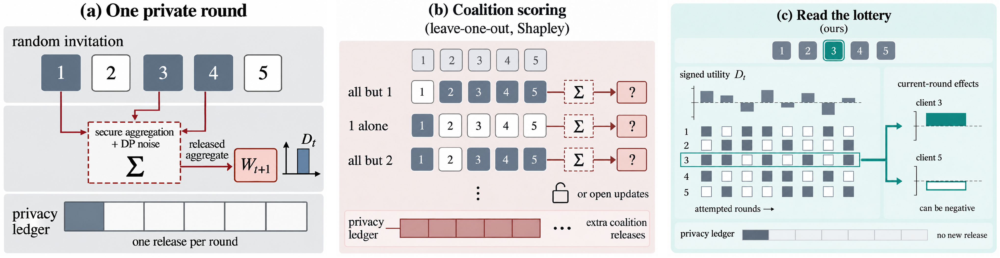

# ClientLottery

ClientLottery estimates the participation effect τ of each client when a federated round includes that client by an independent Bernoulli draw with known probability p. The pre-round state is frozen, the round releases one utility, and an inverse-probability weight turns the invitation into a martingale increment. The average of those increments is the estimator of τ under the lottery that was actually used. The target is that add-one participation effect. It is not a Shapley value, and it does not score extra leave-one-out coalitions.

## The picture

One private round releases a single aggregate. Re-scoring leave-one-out coalitions would spend further releases. The lottery reads the participation effect from the invitations that already happened.

<p align="center">
  
</p>

## Setup

```bash
python -m venv .venv
# Windows: .venv\Scripts\activate
# Unix:    source .venv/bin/activate
pip install -r requirements.txt
```

## Quick start (smoke)

From this directory:

```bash
py scripts/run_experiment.py --protocol smoke
```

Smoke is a short synthetic check (T = 80, one seed). It writes ledgers under `results/`, which is gitignored. A longer window, including T = 50000, is a separate protocol and is not required to try the estimator:

```bash
py scripts/run_experiment.py --protocol paper_large --T 50000
```

Optional cloud helpers live under `scripts/gcp/`. They stay in dry-run until `-Execute` is passed.

## Layout

| Path | Role |
|------|------|
| `clientlottery/` | Bernoulli lottery, inverse-probability estimator, synthetic checks |
| `scripts/run_experiment.py` | Smoke and longer-window CLI |
| `scripts/gcp/` | Optional cloud launch, run, and pull helpers |
| `figures/` | Method figure used above |
| `requirements.txt` | Python dependencies |
